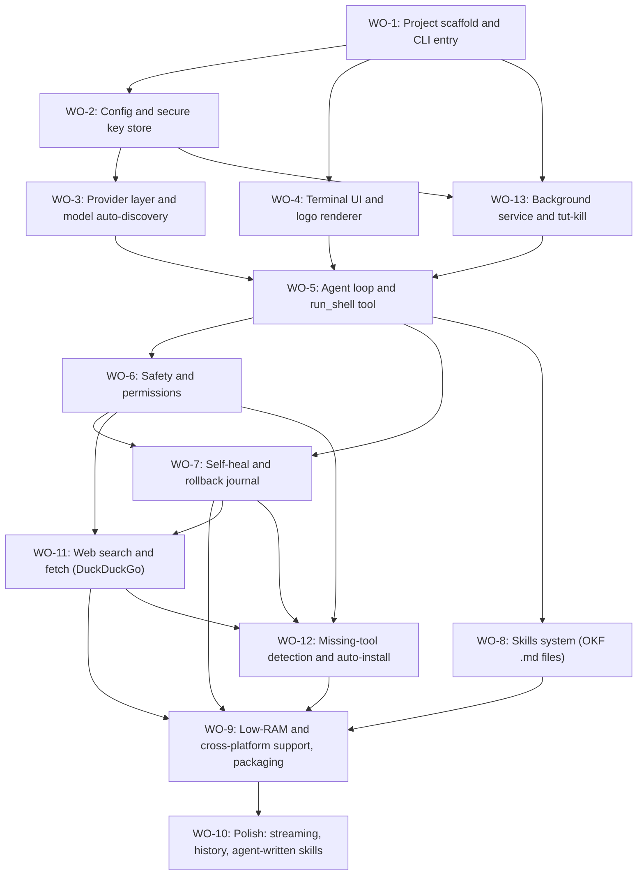

# workOrderMap

Total work orders: **13**
Execution order: WO-1 -> WO-2 -> WO-3 -> WO-4 -> **WO-13** -> WO-5 -> WO-6 -> WO-7 -> WO-8 -> WO-11 -> **WO-12** -> WO-9 -> WO-10
(WO-11, WO-12, WO-13 were added after the first plan, so they keep their numbers but run at the positions above.)
(WO-13 runs before WO-5 so the agent loop is built to run inside the background service.)
(WO-4 can run in parallel with WO-2/WO-3 once WO-1 is done.)

| WO | Title | Goal | Requirements | Depends on | Status | Done-when |
|----|-------|------|--------------|------------|--------|-----------|
| WO-1 | Project scaffold and CLI entry | Global npm package; `tut` runs, `tut --help` and `tut --version` work, REPL stub starts. | R1, R2 | - | DONE | `npm i -g .` then `tut --version` prints version; `tut` opens a prompt and exits cleanly on Ctrl+C. |
| WO-2 | Config and secure key store | ~/.tut/config.json, API keys stored with chmod 600 (or env vars), first-run onboarding. | R10 | WO-1 | DONE | First run asks for provider + key, saves to ~/.tut, file mode 600 on Linux/macOS; env var override works. |
| WO-3 | Provider layer and model auto-discovery | One interface for OpenRouter, xAI Grok, Anthropic, OpenAI, Gemini. Entering a key fetches that provider's model list; user picks one. | R3, R4 | WO-2 | DONE | For each of the 5 providers: valid key lists models, invalid key gives a clear error, chosen model is saved and used for a test chat call. |
| WO-4 | Terminal UI and logo renderer | Render the user's custom logo in the terminal at startup, with colors and a plain fallback; basic prompt/spinner styling. | R8, R2 | WO-1 | IN-PROGRESS | Logo shows on `tut` start in Windows Terminal and on the Pi over SSH; falls back to plain text if colors/Unicode unsupported. |
| WO-5 | Agent loop and run_shell tool | Model can call a run_shell tool; tut runs the command, returns stdout/stderr/exit code to the model, loop continues until the task is done. | R5 | WO-3, WO-4, WO-13 | IN-PROGRESS | Prompt 'show free disk space' makes the agent run `df -h` itself and answer from the real output. |
| WO-6 | Safety and permissions | Permission modes (ask / auto / dry-run), dangerous-command blocklist, confirmation prompts, authorized-target reminder for security tools. | R9, R16 | WO-5 | TODO | In ask mode every command needs approval; blocked commands (for example `rm -rf /`) never run; dry-run only prints.; text from the web or files never runs by itself (a page saying "run rm -rf /" is not executed). |
| WO-7 | Self-heal and rollback journal | On a failed command, read the error, undo what the failed step changed, and retry with a fix, up to a retry limit. Journal every change so it can be reversed. | R6, R11 | WO-5, WO-6 | TODO | Demo: a step that edits a config file and fails is rolled back (file restored from backup), then retried with a corrected command that succeeds. |
| WO-8 | Skills system (OKF .md files) | skills/ folder of OKF markdown files (frontmatter + sections). Loader indexes them, agent searches and reads the right one before acting. Starter skills: nmap and others. | R7, R14 | WO-5 | TODO | Asking 'scan my own network with nmap' makes the agent load skills/nmap.md first and follow it; `tut skills list` shows all skills. |
| WO-9 | Low-RAM and cross-platform support, packaging | Works on Raspberry Pi 4B 1GB (arm64 Kali), Windows, macOS; minimal dependencies; ready to publish to npm. | R12 | WO-7, WO-8, WO-11, WO-12 | TODO | Installs and runs on the Pi (god.local) and on Windows; idle memory under about 100 MB; `npm pack` produces a clean tarball. |
| WO-10 | Polish: streaming, history, agent-written skills | Streamed output, saved session history, and the agent can draft new skills as OKF files after a task. | R13 | WO-9 | TODO | Responses stream; `tut history` lists sessions; after a new task type the agent offers to save a skill file. |
| WO-11 | Web search and fetch (DuckDuckGo) | Agent tools web_search and web_fetch; when self-heal cannot fix an error, or the agent needs to learn a tool, it searches the web, reads pages, and applies what it learns, treating web text as untrusted. | R15, R16 | WO-6, WO-7 | TODO | A real failing task (for example a missing dependency) is fixed by the agent after it searches and reads a page; the query is shown in ask mode with secrets redacted; an injected instruction in a fetched page is not executed. |
| WO-12 | Missing-tool detection and auto-install | Detect a command or tool that is not in the OS, find the right package for this OS and CPU, show a plan, install it after approval, verify, and journal it so it can be undone. | R17 | WO-6, WO-7, WO-11 | TODO | On the Pi: after removing a small tool (for example cowsay), asking tut to use it makes tut detect it is missing, propose `apt install`, install after approval, run it, and undo it from the journal; a GitHub arm64 release install checks the checksum; install is refused when free disk would drop under about 3 GB. |
| WO-13 | Background service and tut-kill | `tut` starts a background service that keeps sessions and jobs alive after the terminal or SSH closes; `tut status`, `tut attach`, `tut logs`; `tut-kill` stops the service and every process it started. | R18 | WO-1, WO-2 | DONE | Start a long job (sleep 600) from `tut`, close the terminal, reconnect: `tut status` shows it running; `tut-kill` stops the service and the job, leaves no processes (`pgrep` empty), and removes the pid file and socket; idle service memory stays under about 60 MB on the Pi. |

Status values: TODO / IN-PROGRESS / DONE / BLOCKED
Rule: never mark DONE until the Done-when column is actually verified.
